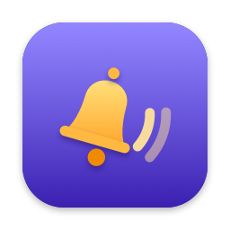

<p align="center"></p>

<h1 align="center">Ding</h1>

<p align="center">A tiny macOS menu bar app for silent reminders, keep-awake and pomodoro breaks.</p>

Ding is for staying in flow until the last useful minute. Set an alarm for 11:44 when your meeting is at 11:45, and a short, silent banner slides in to tell you to move. There are no calendar pop-ups and no sounds.

## Features

- **Alarms and timers.** Type `11:44 move to meeting booth`, `25m`, `1h30m tea` or `90s`.
- **Quick reminders.** Remind me in 5, 10, 15 or 30 minutes, or 1 hour, in one click.
- **Silent popup.** A banner at the top of the screen that doesn't take focus and fades out on its own. You choose how long it stays up for each alarm.
- **Live countdowns.** Every pending alarm shows the time left in the menu.
- **Keep awake.** Like Caffeine: stops the Mac from sleeping, either until you turn it off or for 15 minutes to 8 hours.
- **Pomodoro.** Focus for 25/50/90 minutes (or a custom length), then a full-screen break screen with a countdown. Press Esc to skip the break.
- **Global hotkey.** Press <kbd>⌃⌥⌘D</kbd> in any app to set an alarm.
- **Remembers your alarms** across restarts. **Open at login** is one click.

The menu bar icon shows what's active: the bell is solid while alarms are pending, a mug appears while keep-awake is on, and the minutes left show while a pomodoro is running.

## Install

1. Download `Ding.zip` from the [latest release](../../releases/latest) and unzip it.
2. Move `Ding.app` to `/Applications` and open it.

Ding isn't notarised, so macOS blocks it the first time. Go to **System Settings → Privacy & Security** and click **Open Anyway**, or run:

```sh
xattr -dr com.apple.quarantine /Applications/Ding.app
```

Requires macOS 14 or later, on Apple silicon or Intel.

## Usage

| You type      | Ding goes off            |
| ------------- | ------------------------ |
| `11:44`       | at the next 11:44        |
| `23:15`       | at 23:15 (24-hour clock) |
| `25m`, `10`   | in 25 / 10 minutes       |
| `1h30m`       | in 1.5 hours             |
| `90s`         | in 90 seconds            |

Add a label after a space (`11:44 standup`) and it appears in the popup. Click a pending alarm in the menu to cancel it.

## Build from source

Needs the Xcode command line tools (`xcode-select --install`).

```sh
./build.sh && open Ding.app
```

The app is two Swift files: `main.swift` (the app) and `icon.swift` (the bell, drawn in code for both the menu bar and the app icon). `build.sh` runs a small self-test, builds a universal binary and generates the icon. `VERSION=1.2.0 ./build.sh zip` builds the release zip.
